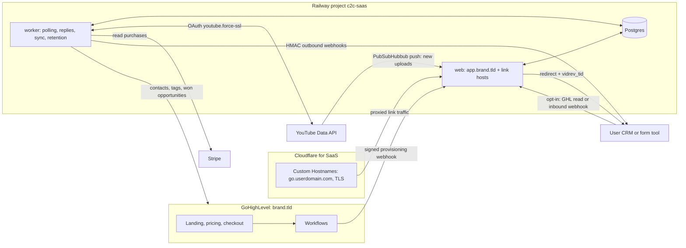

# SPEC (technical specification)

Source: Drive doc "05 C2C SaaS SPEC (technical specification)", draft v1, 2026-09-24, with all "UPDATE" and "APPROVED" notes (2026-09-24/25) merged into the text they override, and the WITHDRAWN Python stack proposal removed. Decisions live in [DECISIONS.md](../DECISIONS.md) and win on any conflict. Product scope is in [PRD.md](PRD.md). Internal codename: `c2c-saas`.

Merge notes (2026-09-29, Phase 14): mandatory onboarding, the Video, Keyword, Target URL flow, the keyword catalog with lead temperature and the new navigation are described in section 3a and DECISIONS section 19.

Merge notes (2026-09-25, Phase 3): owner answers to the Phase 1 review (DECISIONS sections 5 and 6) are merged below; where this file and DECISIONS.md differ, DECISIONS.md wins. Earlier merge notes: env var `LINK_BASE_URL` is renamed `LINK_FALLBACK_BASE_URL` (CC-01); the tracking parameter is `vidrev_tid` (CC-02); references to the legacy C2C app as a pattern are dropped (CC-04, D-30).

## 1. Principles

- Platform-independent core. GoHighLevel (GHL) is a connector, not the foundation.
- Only real metrics. No estimated values anywhere.
- Names and domains are configuration, never hardcoded (product name and domains are undecided).
- Boring, well-supported tech; low running cost during beta.
- YouTube and Google policy compliance is a hard requirement, not a feature.
- Performance: the UI never waits on YouTube or GHL; all external calls run in the worker; dashboards read precomputed aggregates; approvals use optimistic UI (D-36).

## 2. Stack (approved, D-36)

| Layer | Choice | Reason |
| --- | --- | --- |
| Language | TypeScript (Node.js LTS) | One language for web, worker and scripts |
| Web app and API | Next.js (App Router) | Dashboard, API routes and public pages in one service |
| Background jobs | Separate worker process using pg-boss (Postgres-backed queue) | No Redis needed, fewer services, lower cost |
| Database | PostgreSQL (Railway) | Relational data, transactional quota ledger |
| ORM and migrations | Drizzle ORM | Typed SQL, simple migrations |
| Email | Resend (magic links, audit reports, fallback resource email) | Simple API, good deliverability |
| Hosting | Railway project `c2c-saas`: services `web`, `worker`, plus Postgres | No Supabase, no Upstash, no Redis (D-29) |
| Tests | Vitest | Fast unit tests |

The tracked link redirect is served by the `web` service, routed by host name (user custom hostnames and the fallback link host). Split it into its own service only if traffic requires.

## 3. Architecture

## 3a. App structure and onboarding (Phase 14)

- Checkout and card happen in GoHighLevel first (provisioning webhook, unchanged). After the first sign-in the app is locked behind `/onboarding` until `accounts.onboarded_at` is set. Steps, each blocking the next: 1 YouTube channel (OAuth), 2 GoHighLevel (Marketplace OAuth; no other CRM offered), 3 purchase source (`accounts.purchase_source`: GoHighLevel payments and won opportunities, or a Stripe restricted key), 4 default target URL (`accounts.default_target_url`, prefilled from the Sub-account website). Links run on the fallback link host; the creator's own domain is optional under Settings.
- Before onboarding is complete no channel is polled, no RSS is read, no AI draft is written and no quota is spent. Once stamped, `onboarded_at` is never unset; a later disconnect shows in Settings.
- Navigation: Home (approval queue and this month's numbers), Campaigns (new campaign and live rules), Reports, Settings (dropdown and side menu: Account, Billing and cancel; YouTube channel, GoHighLevel, Stripe; Webhooks, Inbound endpoints, marked self-service; Replies: language and AI; Linked domain), Owner admin for `ADMIN_EMAILS` only (server gated). Old paths redirect.
- Campaign flow, in order: 1 Video (pick at least one from the channel's public feed plus known videos, no API quota, or paste links; or "All my videos, including new uploads"), 2 Keyword (from the catalog in `src/lib/keyword-catalog.ts`, GUIDE first; each keyword carries its lead temperature Cold, Warm or Hot; misspellings generated automatically and editable under Advanced; own keywords later), 3 Target URL (default from onboarding). Then the reply is drafted and waits for approval (unchanged engine).

## 4. Domains and configuration

ONE owner domain is enough (D-28).

| Role | Host | Runs on |
| --- | --- | --- |
| Brand, landing, pricing, checkout, Privacy, Terms | brand.tld | GHL |
| App (dashboard, API, OAuth callbacks, Audit my channel) | app.brand.tld | Railway `web` |
| Tracked links, default (MISSION CRITICAL, D-33) | the user's own domain, e.g. go.userdomain.com, via CNAME, automatic TLS through Cloudflare for SaaS (Custom Hostnames) | Railway `web` (host routing) |
| Tracked links, fallback for users without a domain | go.brand.tld | Railway `web` (host routing) |

Custom domains are a core MVP feature, not a stub. Google verification concerns only the app domain; one verified root domain (`brand.tld`) covers the Google OAuth consent screen homepage and privacy policy.

Environment variables (see `.env.example`): `PRODUCT_NAME`, `BRAND_BASE_URL`, `APP_BASE_URL`, `LINK_FALLBACK_BASE_URL`, `DATABASE_URL`, `ENCRYPTION_KEY` (32-byte, base64), `AUTH_SECRET`, `GOOGLE_CLIENT_ID`, `GOOGLE_CLIENT_SECRET`, `WEBSUB_SECRET`, `YT_API_KEY_AUDIT` (separate GCP project), `RESEND_API_KEY`, `EMAIL_FROM`, `PROVISIONING_SECRET`, `CLOUDFLARE_API_TOKEN`, `CLOUDFLARE_ZONE_ID`, `CUSTOM_HOSTNAME_CNAME_TARGET`, `GHL_CLIENT_ID`, `GHL_CLIENT_SECRET`, `STRIPE_CONNECT_CLIENT_ID`, `STRIPE_SECRET_KEY`, `QUOTA_DAILY_LIMIT` (default 10000).

## 5. Data model (core tables)

| Table | Key fields |
| --- | --- |
| accounts | id, name, status (active, suspended), plan_code, trial_ends_at, billing_ref (subscription id), suspended_at, reporting_currency, onboarded_at, purchase_source (ghl, stripe), default_target_url, created_at, updated_at |
| users | id, account_id, email (normalized, unique), name, last_login_at. One user per account for the MVP |
| sessions | id, user_id, token_hash, expires_at (30 days) |
| magic_link_tokens | token_hash, user_id, expires_at (15 min), used_at (single use) |
| plans | code, label, billing (monthly, annual, free_grant, custom), price_label, channel_limit, monthly_reply_cap, daily_reply_cap, seats_cap, features (jsonb), active. A null cap means no plan cap |
| provisioning_events | id, source (ghl), event, external_id, payload (jsonb), account_id, result, received_at. Unique on (source, event, external_id) |
| channels | id, account_id, youtube_channel_id, title, title_refreshed_at, default_language, refresh_token_enc, access_token_enc, token_expires_at, scopes, status (connecting, connected, disconnecting, disconnected, revoked, rejected), status_reason, connected_at, disconnected_at. A YouTube channel is live in one account at most |
| audit_log | id, actor, account_id, action, details (jsonb), created_at |
| videos | id, channel_id, youtube_video_id, title, published_at, poll_tier, last_polled_at |
| campaigns | id, channel_id, name, keyword (from the catalog), aliases (misspellings), intent (the lead temperature: cold, warm, hot), destination_url, video_ids (null means all videos), active; replies are approval only (D-25) |
| templates | id, campaign_id, language, body, approved_at |
| comments | id, video_id, youtube_comment_id, author_channel_id, text, language, matched_campaign_id, fetched_at, refresh_due_at (API data, 30-day rule) |
| replies | id, comment_id, template_id, status (queued, pending_approval, sent, failed, skipped), youtube_reply_id, sent_at, error |
| links | id, campaign_id, video_id, slug |
| clicks | id, link_id, tracking_id (tid), comment_id, ip_hash, user_agent_class, is_bot, created_at |
| subscribers | id, account_id, email_norm, tid, campaign_id, video_id, source (ghl, webhook, hosted), consent_marketing, created_at |
| purchases | id, account_id, email_norm, amount_cents, currency, source (ghl, stripe, webhook), external_id, refunded_cents, occurred_at, attributed_subscriber_id |
| integrations | id, account_id, type (ghl, stripe, outbound_webhook), config_enc, status |
| outbound_deliveries | id, integration_id, event, payload, attempt, status, next_attempt_at |
| quota_ledger | id, gcp_project (app, audit), date_pt, method, units, account_id, created_at |
| audits | id (uuid, the result URL token), channel_key, channel_input, status (queued, running, done, failed), failure_reason, youtube_channel_id, result (jsonb, counts only), examples (jsonb, API-derived, wiped after 30 days), fetched_at, api_data_scrubbed_at, requester_email, consent_marketing, consent_at, report_sent_at, created_at. Built in Phase 9 |

Accounts, users, sessions, magic_link_tokens, plans, provisioning_events, channels, quota_ledger and audit_log exist since Phase 3; the other tables follow the SPEC-REVIEW R-06 additions in their phases. Phase 6 adds `integrations` (with `sync_state`, `external_ref`, `events`), `outbound_deliveries` (the outbox: `event_id`, `payload`, `attempt`, `status`, `next_attempt_at`), `inbound_hook_secrets`, `subscribers` (one row per opt-in touch, with the click's campaign, video and keyword copied in) and `purchases` (`source`, `kind` payment or buyer_marker, `external_id`, nullable amount, `refunded_cents`, `subscription_ref`, `canonical_purchase_id` and `attributed_subscriber_id` for Phase 7); see DECISIONS section 11. Environment additions: `GHL_SCOPES`, `GHL_WEBHOOK_PUBLIC_KEY`. All `*_enc` fields are encrypted with AES-256-GCM using `ENCRYPTION_KEY`, stored as `v1:<base64(iv, tag, ciphertext)>` so the key can be rotated. Emails are normalized (trimmed, lowercased) for matching.

## 6. Plans and provisioning (billing lives in GHL)

- Plans are rows in `plans`, never code branches. Required seed plans:
  - `standard_monthly`: billing monthly, price configurable.
  - `founding` (D-24): billing annual, 97 USD per year, renewal price locked for life, seat cap 100.
  - `ghl_affiliate_free` (D-21): free app access for users who subscribe to GHL through the owner's affiliate link; granted manually or by webhook.
  - `enterprise` (D-32): BYOK, the customer's own GCP project and OAuth client.
  - `internal`: owner accounts.
  - No lifetime plan (D-20). No forever-free plan; the free entry point is Audit my channel (D-37).
- Caps (DECISIONS Q-03 / Q-11): every plan gets 300 replies per month and a safety ceiling of 30 replies per channel per day (spam protection); enterprise and internal have no monthly plan cap. 1 channel per account; enterprise and internal configurable. The trial gets exactly the paid limits.
- Trial (D-37): 14 days, card required, run by GHL checkout, only for `standard_monthly`; the founding offer has no trial (Q-16).
- `POST /api/provisioning/ghl`: called by GHL workflows ([GHL-PROVISIONING.md](GHL-PROVISIONING.md)). `Authorization: Bearer <PROVISIONING_SECRET>`; an `X-Signature` HMAC is verified when present (Q-04). Idempotent on (event, external_id).
  - `purchase` or `subscription_created`: create or activate the account, assign the plan, clear the trial, send a sign-in link to new or reactivated accounts.
  - `trial_started`: create the account with `trial_ends_at` (default 14 days); ignored for paying accounts; 422 for `founding`.
  - `subscription_cancelled`, `payment_failed`: suspend, only when `subscription_id` matches the activating subscription (P3-01). Suspended accounts can sign in and see reports; polling, sending and new connections stop.
  - `plan_changed`: switch plan.
  - Unknown plan code: 422, owner email, event not stored so a resend works (P3-02).
- Payload fields: `event`, `external_id` (occurrence id), `email`, `name`, `plan_code`, `subscription_id`, `occurred_at`, `trial_ends_at`.
- Founding seats: GHL stops selling at 100; the app never rejects a paid purchase and emails the owners (`ADMIN_EMAILS`) at 90 and 100 (Q-20).
- Login: magic link by email (Resend via the worker), single use, 15 minutes, hashed, 5 requests per 15 minutes per user; consumed on POST only (P3-04). 30-day session cookie, SameSite=Lax, plus an Origin check on every form post.
- Owner admin `/admin`, limited to `ADMIN_EMAILS` (Q-21): grant access (for example `ghl_affiliate_free`), change plan, suspend, reactivate; every action goes to `audit_log`. Owner accounts are seeded on the `internal` plan (P3-06).
- Plan limits enforced in the worker: channel_limit on connect, the monthly and daily caps before each reply (excess replies become `skipped` with a visible reason).

## 7. YouTube integration

### OAuth

- Scopes: `openid email profile https://www.googleapis.com/auth/youtube.force-ssl`. Offline access with PKCE and `prompt=consent`, tokens encrypted at rest. If the YouTube permission is unticked (granular consent) or no refresh token is returned, the grant is revoked and the user is asked to connect again.
- Connect flow: the web callback exchanges the code and stores a `connecting` channel; the worker calls `channels.list mine=true` (1 unit, ledgered) and connects it, or rejects it (no channel, already live in another account, account suspended) and revokes the grant (P3-05, P3-07). Setup steps: [SETUP-GOOGLE.md](SETUP-GOOGLE.md).
- Revocation: a refused refresh (`invalid_grant`) marks the channel `revoked` and wipes its tokens and YouTube data. A user disconnect revokes the grant at Google and deletes the channel's YouTube data at once (policy: within 7 days).
- Enterprise plan (D-32): BYOK, the customer's own GCP project and OAuth client with its own quota, selected per account; no on-premise.

### Polling and quota

- Channel-level listing: `commentThreads.list` with `allThreadsRelatedToChannelId`, `order=time`, page until the last seen comment. 1 unit per page. Never poll per video.
- Schedule is per CHANNEL and activity-based (D-27):
  - channel with a video published in the last 48h: every 2 min;
  - normal: every 15 min;
  - no upload in 14 days: every 60 min.
- Old videos cost nothing extra because one channel-level call covers all of them.
- New uploads are detected WITHOUT quota via YouTube PubSubHubbub push notifications (fallback: channel RSS feed), which switches the channel to the 2-minute tier for 48h.
- Only active channels are polled: at least one enabled campaign (a watched keyword) and the account not suspended (Q-02). The tier intervals are targets; when their sum exceeds the polling budget, one global factor stretches all of them.
- Daily quota budget: `QUOTA_DAILY_LIMIT` units per Pacific-time day for the app GCP project, shared by ALL customers. 75% of it is the reply reserve (stored as data, Q-02); polls yield when the reply reserve is at risk. Replies are shared fairly across accounts (round robin by account, FIFO within an account).
- Reply sending (D-31b): an approved reply is sent immediately when it fits today's reply budget; replies above the budget wait and are sent first after the midnight PT reset. Before the quota extension the zero-quota manual fallback carries the rest, with an honest note that this is YouTube's daily limit.
- Onboarding gate before the quota extension: all 100 founding buyers, then a waitlist. The quota extension is requested as soon as the owner's channel runs end to end.
- Approved replies that cannot be sent today stay in a transparent queue showing the estimated send time and an honest note that YouTube limits daily API actions, plus the manual "Copy reply and open comment on YouTube" fallback (0 units).
- Per-plan monthly reply caps apply.
- NEVER use multiple GCP projects for the same use case to increase quota (prohibited by the YouTube Developer Policies); a separate project is allowed only for a genuinely different use case (Audit my channel, D-34).
- The quota audit is an upside, not a dependency (D-27, D-35).
- Every API call writes a `quota_ledger` row (method, units). Before any call the worker checks remaining units for the Pacific-time day; replies get priority reservations. Dashboard shows today's usage.
- Unit costs: list calls 1, `comments.insert` 50.

### Reply engine

1. Only top-level comments trigger; replies inside a thread never do (Q-19). Normalize, then match campaign keywords anywhere in the comment, whole word, case-insensitive, with aliases (Q-10). False positives are filtered by the creator in the approval queue.
   - Several keywords in one comment: one reply. Each keyword has a lead temperature Hot, Warm or Cold (set by the keyword catalog; stored as `intent`); the hottest wins, then a video-scoped campaign over a channel-wide one, then the keyword that appears first. The approval card lists the other matches and lets the creator switch (Q-10b).
2. Skip if: author is the channel owner, plan cap or the daily safety ceiling reached. Commenters are not deduplicated (Q-14): every keyword comment gets a draft; the queue may show "already replied to this person on this video" as information only.
3. Language (B-06): detect comment language; use an approved template in that language if one exists; else the channel `default_language` template; else English.
4. Draft: generated by AI with the owner's platform Gemini key (billing-enabled project, no training) by default; the creator may switch to their own Anthropic, OpenAI or Gemini key, encrypted at rest (Q-13c). Model names are configuration. The commenter's name is never sent to the AI. Falls back to approved templates. Rotate among approved templates, append the tracked link.
5. Every reply is a draft (`pending_approval`) until the creator approves it, one by one: no auto mode (D-25) and no bulk approval (Q-12). Drafts are ready as soon as the comment is found, and an email (web push later) links to a mobile-friendly approval queue (R-35).
6. After approval: scheduled by the quota budget, then sent via `comments.insert` (reply to the top-level comment) with 30 to 180 s jitter. Record result; retry transient errors with backoff; never retry policy errors.

- No machine translation of unapproved text.
- No like or subscribe requirements in templates (validated on save).

### Retention (30-day rule)

- Owner rule (DECISIONS Q-17 c), for every phase: (1) YouTube data from the creator's OAuth (comment text, commenter names and channel ids, video and channel titles, reply ids) is deleted or refreshed within 30 days; consent does not extend this (YouTube API Developer Policies III.E.4). (2) First-party data (replies we sent, clicks, opt-ins, purchases, aggregate counts) is kept while the account is active. (3) Disconnecting YouTube deletes all YouTube-derived data within 7 days (done immediately); closing the account or uninstalling deletes all data of that account. (4) The Privacy Policy and Terms state this in a separate, prominent section.
- Daily job (Phase 4): comments older than 30 days are either refreshed (batched `comments.list` by id, 1 unit per up to 50) while their campaign is active, or deleted; channel and video titles are refreshed the same way. Aggregates are kept.

## 8. Tracked links

- Hosts: the user's own custom hostname by default (D-33), `LINK_FALLBACK_BASE_URL` for users without a domain.
- Format: `{link host}/{slug}`; slug is unique per campaign and video.
- On click: create a `tid` (short random id), log the click (bot filter by user agent and known crawlers), redirect 302 to `destination_url` with `vidrev_tid={tid}` and `utm_source=vidrev`, `utm_medium=comment`, `utm_campaign=<keyword>`, `utm_content=<tid>` appended (preserving existing query parameters).
- Three capture layers (CC-07): (1) UTM parameters, stored automatically by most form tools and CRMs; (2) the hidden `vidrev_tid` field; (3) on the creator's own subdomain the redirect sets a first-party cookie on the registrable domain, and an optional script on the opt-in page fills the hidden field from it, so a visitor who returns later is still attributed. No match without a tracking id or email; never estimated.
- Tracked links keep redirecting after a cancellation; only measurement stops (R-35).
- Custom domain onboarding (core MVP, mission critical): the user adds a CNAME (e.g. go.userdomain.com) to the link service; the app verifies DNS and provisions automatic TLS via Cloudflare for SaaS (Custom Hostnames).

## 9. Opt-in capture (subscribers)

| Method | How |
| --- | --- |
| GHL (native connector) | User adds a hidden field `vidrev_tid` to their GHL form. The worker reads new contacts with that field (GHL API or GHL webhook) and creates `subscribers` rows |
| Universal inbound webhook | `POST /api/hooks/optin` with `tid`, `email`, optional `name`; per-account secret. Works with any form tool via its webhook, Zapier, Make or n8n |
| Hosted fallback | Minimal hosted opt-in page plus resource email via Resend, for users without any system (D-08) |

Each opt-in emits outbound `opt_in` and applies tags where the connector supports it.

## 10. Purchases and attribution

- Sources: GHL (won opportunity or buyer tag, with value), Stripe (read-only via Stripe Connect OAuth: `checkout.session.completed`, `invoice.paid`, `charge.refunded`), universal inbound webhook `POST /api/hooks/purchase`.
- Matching: normalized email to subscriber. If the purchase carries a `vidrev_tid`, prefer it.
- Attribution rule (default, configurable per account): **last touch** before the purchase within a 180-day window (B-08). Refunds reduce revenue.
- Metrics: buyers = unique purchasing emails; revenue = sum of net amounts.
- Phase 7 (DECISIONS section 12, P7-01 to P7-04): duplicates across sources link to one canonical purchase (same buyer, currency and amount within 72 hours); the purchase's own `vidrev_tid` first, else the latest attributed opt-in of the email, within 180 days; renewals follow the first payment of the subscription for life (Q-07); the whole account is recomputed by the worker after new data.

## 11. Outbound webhooks

- Events: `comment_matched`, `reply_posted`, `link_clicked`, `opt_in`, `purchase`.
- Payload: `{ "event", "id", "occurred_at", "account_id", "channel_id", "video_id", "campaign", "keyword", "tid", "email" (opt_in/purchase only), "amount_cents", "currency" }`.
- Header `X-Signature` = HMAC-SHA256 of the raw body with the integration secret; `X-Event-Id` for idempotency. Retries with exponential backoff for 24 hours.
- Tag scheme for CRMs with tags (DECISIONS A-11): `vidrev`, `vidrev-source-youtube`, `vidrev-keyword-<keyword>`, `vidrev-temperature-<cold|warm|hot>-lead`, `vidrev-video-<videoId>`, `vidrev-buyer`.

## 12. Reporting

- Per video and per keyword: comments matched, replies sent, clicks, subscribers, buyers, revenue, conversion rates (reply to click to subscriber to buyer).
- Headline (Q-09, replaces the D-05 sentence): attributed revenue this month and lifetime, the recurring part of it, and the subscription cost as a percentage of attributed revenue ("Your subscription cost 0.13% of what your comments made"). The percentage line is omitted on free plans or when revenue is zero.
- Also (R-35): clicks and buyers per reply template and per lead temperature (Hot, Warm, Cold); approval time vs conversion; a weekly email with the week's attributed revenue; a permanent ROI line; instant milestone notifications (first click, subscriber, buyer).
- Date filters (this month, last 30/90 days, all time). All numbers derived from stored events; no estimates. Dashboards read precomputed aggregates.
- UI vocabulary: Comment, Subscriber, Buyer, Revenue (B-01).
- Phase 7 (DECISIONS section 12, P7-05 to P7-13): `report_snapshots` per account and period (this month, last 7, 30, 90 days, all time) in the account's time zone, rebuilt by the worker; `/app/reports`; headline on `/app`; weekly email, milestone emails, renewal recap, `/app/settings/billing`. Plans carry `price_cents` and `price_currency`; env addition `BILLING_PORTAL_URL`.

## 13. Audit my channel

- Public page on `app.brand.tld/audit`. API key from a separate GCP project (`YT_API_KEY_AUDIT`, D-34), no OAuth.
- Calls: `channels.list` (`forHandle`), `playlistItems.list` (last 5 videos), `commentThreads.list` per video (up to 2 pages). About 5 to 15 units per audit; own `quota_ledger` project.
- Output (real numbers only): unanswered questions, buying-intent comments, repeated words as keyword candidates, description link audit (tracked or not, own domain or not), stack detection by following description links (GHL, Kit, Kajabi and others; same signatures as the 03 research), Comment Conversion Score 0 to 100 from these factors.
- Instant preview (3 findings), then full report by email (opt-in, consent recorded), then trial CTA. 24h cache per channel, IP rate limit, raw comments deleted within 30 days.
- Built in Phase 9 (DECISIONS section 16, P9-01 to P9-12; owner setup in [SETUP-AUDIT.md](SETUP-AUDIT.md)): `/audit` (form) and `/audit/<uuid>` (result, `noindex`); the web service only creates an `audits` row and queues `audit.run`, the worker calls YouTube with `YT_API_KEY_AUDIT` (`quota_ledger.gcp_project = "audit"`, `AUDIT_DAILY_LIMIT`, at most 13 units per audit) and fetches description links through an SSRF-guarded fetcher (3 redirects, 5 s, 1 MB). Calls: `channels.list`, `playlistItems.list`, `videos.list` (descriptions), `commentThreads.list` with replies (up to 2 pages per video, last 5 videos). Comment text is analysed in memory and never stored; `audits.result` keeps counts, the score and its factors, `audits.examples` keeps API-derived pointers, titles and links and is wiped 30 days after `fetched_at`. Comment Conversion Score and instant preview rules: P9-08, P9-09. The full report is emailed only to the address entered (P9-10); marketing consent is a separate unchecked box. Optional Cloudflare Turnstile (`TURNSTILE_SITE_KEY`, `TURNSTILE_SECRET_KEY`). Env additions: `AUDIT_DAILY_LIMIT`, `TURNSTILE_SITE_KEY`, `TURNSTILE_SECRET_KEY`.

## 14. GHL Marketplace connector

- A free GHL Marketplace app (location-level OAuth, D-22). Created as Private in Phase 6 (cap: 5 agencies), switched to Public with "Start Public review" in Phase 10 (Q-17 b). Billing stays in the owner's GHL checkout. On install: store tokens in `integrations`, map the location to an account (existing or invite), create the `vidrev_tid` custom field and tags.
- Capabilities: write contacts and tags; read contacts with `vidrev_tid`; read won opportunities and buyer tags; optional workflow trigger ("vidrev subscriber created") and action ("Add note: vidrev source").
- The connector does not handle billing.

## 15. Security and compliance

- Secrets only in env vars; `.env` git-ignored. Tokens, AI keys and integration configs encrypted at rest.
- Inbound webhooks verified by HMAC; outbound signed. Rate limits on public endpoints.
- Privacy Policy and Terms (drafts, marked "DRAFT - needs legal review") on `brand.tld`: YouTube API Services disclosure, link to the Google Privacy Policy, data accessed and stored, revocation via Google security settings, Limited Use statement, link to YouTube Terms of Service.
- No Google user data used for model training. Account deletion removes all personal data.
- No "YouTube", "YT", "Tube" or "GHL" in product naming (D-23).
- Owner entity: Wyoming LLC (not formed yet, D-13).

## 16. Observability

- Structured logs, error tracking (Sentry free tier or equivalent), health endpoint, worker heartbeat, quota and delivery dashboards for the owner.
- Built (reliability review 2026-09-29, DECISIONS section 20): one-line JSON logs with error type, short stack and cause (`src/lib/log.ts`); every worker queue through `runJob` (failed attempts logged with queue, job id, attempt, payload ids; the last attempt emails the owner, at most once an hour per problem); scheduled jobs as independent steps (`runSteps`); 20 s limit on every outbound call (`src/lib/http.ts`); missing settings fail loudly (`MissingConfigError`); every creator and owner action in the log and in `audit_log` (`src/server/events.ts`); every inbound hook and GoHighLevel event logged with its outcome; every server error of a page or route logged by `src/instrumentation.ts` with the digest the error page shows; `/api/health/worker` (503 when the worker heartbeat is stale, for an external uptime monitor); System health panel on `/admin`. Sentry is not used; the logs plus owner emails cover it for the founding cohort.

## 17. Testing

- Unit: keyword matching, language cascade, template validation, quota accounting and reply scheduling, plan caps, custom domain verification, HMAC signing and verification, attribution matching (email, tid, window, refunds).
- Integration: provisioning webhook idempotency, redirect and tid propagation, retention job.
- Manual: OAuth connect, end-to-end on the owner's channel before any customer.

## 18. Open decisions (owner)

1. Product name and domains (env vars until decided). **Open.**
2. Founding offer: **resolved** (D-24). Pricing structure: **resolved** (D-37). Standard monthly price: **open**, configurable.
3. Attribution rule default: **resolved**, last touch within 180 days (B-08).
4. Whether the new SaaS replaces the legacy GHL Marketplace app: **resolved**, yes, legacy frozen then retired (D-26).
